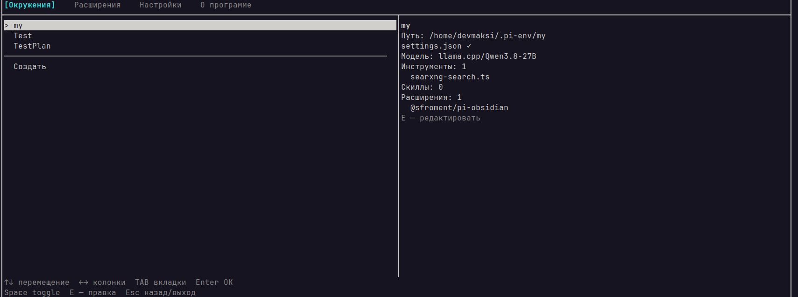

# pi-env

[English](README.en.md) | [Русский](README.md)

[](https://www.npmjs.com/package/@devmaksi/pi-env)
[](https://www.npmjs.com/package/@devmaksi/pi-env)
[](https://github.com/devmaksi/pi-env/actions/workflows/ci.yml)
[](LICENSE)
[](package.json)

**Profiles for the `pi` agent: a separate configuration per project and model, created and launched from one TUI.**

`pi` reads its configuration from the directory pointed to by
`PI_CODING_AGENT_DIR`: `settings.json`, `extensions/`, `skills/`, `agents/`,
`themes/`, `mcp.json`. Different models, skills and MCP servers per task mean
different directories. `pi-env` makes them manageable: a list of environments,
a creation form, launch on Enter, extension and MCP updates in place — without
leaving the terminal.



## Quick start

**Requirements:** Node.js ≥ 22.19 and the `pi` CLI installed
(`npm install -g @earendil-works/pi-coding-agent`).
(the Node floor matches `pi` itself: pi 1.3/1.4 requires Node.js 22.19 or newer)

```bash
npm install -g @devmaksi/pi-env                  # or one-off: npx @devmaksi/pi-env
pi-env                                           # TUI, environments root — ~/.pi-env
pi-env myenv --mode json "Review this repository"  # run pi in the environment (args passed as-is)
```

## Why not just `PI_CODING_AGENT_DIR`

- You still have to remember the variable, export it, and keep paths in your
  head — `pi-env` turns that into a list of names and Enter to launch.
- A new environment is not a `mkdir`: it needs tools, skills, packages, the
  model catalog and `auth.json` copied over. The creation form does it for you.
- Extensions and MCP servers live in separate files per environment; `pi-env`
  shows available updates and edits `mcp.json` for you.
- Launch remains a plain `pi` run: the child process gets
  `PI_CODING_AGENT_DIR=<environment>`, arguments pass through untouched — so it
  is scriptable, `--mode json` included.

## Not to be confused with `@earendil-works/pi-env`

This is an independent project, not affiliated with earendil-works. The official
`@earendil-works/pi-env` is about remote execution (`ssh`, `remote`, durable
agents) and has nothing to do with managing local configurations. Similar name,
different purpose.

## Features

- list of environments (root directory `~/.pi-env`, overridable via the
  `--root <path>` flag or the `PI_ENV_ROOT` environment variable);
- tabs: **Environments | Extensions | MCP | Settings | About**;
- environment creation via a form: name, model, tools, extension packages,
  skills (catalog is taken from the main `pi` agent), MCP servers;
- launching an environment: a child `pi` process with
  `PI_CODING_AGENT_DIR=<environment path>`, back to the TUI on exit;
- environment editing: change model, tools, packages, skills, MCP, rename,
  delete with confirmation;
- extension management: update checks («↑ latest» markers), updating
  one/all packages (`pi update`), removal (`pi remove`);
- installing extensions from the `https://pi.dev/packages` catalog: globally
  (the “Extensions” tab) and into a specific environment (“Install” button
  in the form);
- MCP: a tab with the server list, form-based addition (`pi mcp add`), removal,
  and live connection status (`pi mcp list --json`);
- environment details: info panel of the selected one (model, tools, skills,
  extension packages, MCP);
- application settings: “Colored output”, “Recheck updates”
  (`npm outdated` on every visit to the “Extensions” tab); stored in
  `<root>/.pi-env.json` and survive restarts.

## Controls (main keys)

| Key                      | Action                                                              |
| ---------------------------- | --------------------------------------------------------------------- |
| ↑/↓                          | move through the list                                                  |
| ←/→                          | column focus (wide mode, “Environments” tab)                    |
| TAB                          | switch tabs                                                  |
| Enter                        | confirm (launch environment, action on the selected item)         |
| Space                        | mark in creation lists / toggle in settings (color, recheck) |
| E                            | edit the selected environment                                     |
| X                            | remove the selected extension (with confirmation)                       |
| printable characters / Backspace | entering a name (creation form)                                           |
| ESC                          | back from a sub-screen / exit                                           |
| Ctrl+C                       | emergency exit                                                       |

## Installation

```bash
npm install -g @devmaksi/pi-env   # or one-off: npx @devmaksi/pi-env
```

All installation methods (including Node.js setup), removal, and notes
(TTY, Windows) — in [docs/installation.en.md](docs/installation.en.md).

## Documentation

- [Installation](docs/installation.en.md) — Node.js, pi-env install/remove
- [Development](docs/development.en.md) — stack, quick start, project structure,
  conventions
- [CHANGELOG.md](CHANGELOG.md) — release history
- [AGENTS.md](AGENTS.md) — environments model, current status, roadmap

## For the pi agent

The package ships a `pi-env` skill: install it as a Pi package
(`pi install npm:@devmaksi/pi-env`) and the agent can create environments,
launch them, and explain what lives in `settings.json`. Manual reference is in
[SKILL.md](pi/skills/pi-env/SKILL.md).
